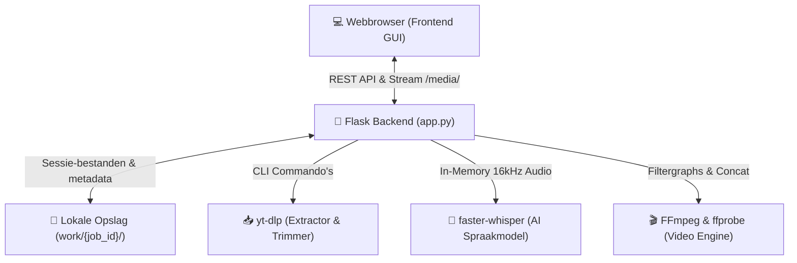
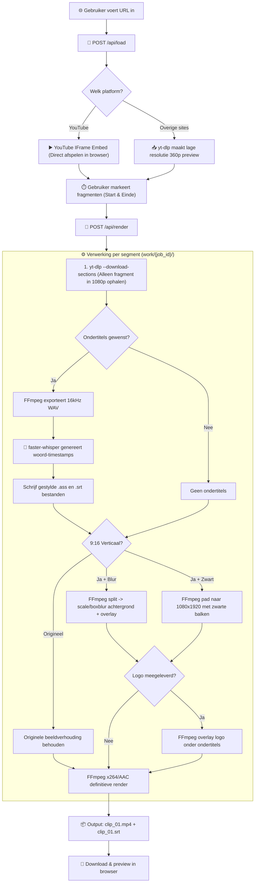
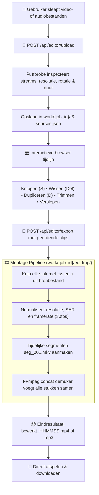

# ClipAPP

Een complete, privacy-vriendelijke video clipper en tijdlijn-editor gebouwd met Python Flask, FFmpeg, yt-dlp en faster-whisper.

---

## Systeemarchitectuur & Visuele Schema's

ClipAPP bestaat uit twee kernpipelines: de **Clipper Pipeline** (voor webvideo's) en de **Tijdlijn Editor Pipeline** (voor lokale mediabestanden).

### 1. Overzicht Architectuur



---

### 2. Clipper Pipeline (Weblink naar Shorts / Clips)

Dit schema toont hoe een externe video wordt geanalyseerd, doelgericht in fragmenten wordt opgehaald, door Whisper van ondertitels wordt voorzien en naar 9:16 verticaal formaat wordt geconverteerd:



---

### 3. Tijdlijn Editor Pipeline (Lokale Bestanden naar Geheel)

Dit schema toont hoe lokale video- en audiobestanden worden geüpload, op een interactieve tijdlijn worden gemanipuleerd en naadloos worden samengevoegd:



---

## Gebruikte Technologieën

| Component | Tool / Bibliotheek | Rol & Doel |
| :--- | :--- | :--- |
| **Webserver** | [Flask](https://flask.palletsprojects.com/) | Lokale server, API-routing en taakisolatie per sessie (`work/{job_id}/`). |
| **Media Downloader** | [yt-dlp](https://github.com/yt-dlp/yt-dlp) | Snel ophalen van metadata en doelgerichte fragment-extractie in 1080p. |
| **AI Ondertiteling** | [faster-whisper](https://github.com/SYSTRAN/faster-whisper) | CTranslate2 Whisper spraakherkenning met woord-voor-woord timestamps (100% lokaal). |
| **Video & Audio Engine** | [FFmpeg](https://ffmpeg.org/) & `ffprobe` | Transcoding, filtergraphs (boxblur, crop, scale), logo-overlays en concat montage. |
| **Frontend GUI** | HTML5 / Vanilla JS & CSS | Donkere Pro-Studio interface met multitrack-tijdlijn zonder zware frameworks. |

---

## Privacy & Lokale Verwerking

- **100% Lokaal**: Zowel spraakherkenning (`faster-whisper`) als videoverwerking (`ffmpeg`) draaien volledig op je eigen processor / videokaart.
- **Geen externe cloud uploads**: Er worden geen persoonlijke opnames of video's naar servers van derden verstuurd.

---

## Vereisten

- Python 3.10 of nieuwer
- [FFmpeg](https://ffmpeg.org/download.html) geïnstalleerd en bereikbaar via je systeem PATH.

---

## Installatie & Gebruik

1. **Clone de repository**:
   ```bash
   git clone https://github.com/jouw-gebruikersnaam/clipAPP.git
   cd clipAPP
   ```

2. **Maak een virtuele omgeving aan en activeer deze**:
   ```bash
   python -m venv venv
   # Windows:
   venv\Scripts\activate
   # macOS/Linux:
   source venv/bin/activate
   ```

3. **Installeer de benodigde packages**:
   ```bash
   pip install -r requirements.txt
   ```

4. **Start de app**:
   ```bash
   python app.py
   ```

5. Open je browser op:
   - **Clipper**: `http://127.0.0.1:5050/`
   - **Tijdlijn Editor**: `http://127.0.0.1:5050/editor`

---

## Disclaimer & Fair Use

Deze software is uitsluitend ontwikkeld voor educatieve en persoonlijke doeleinden, voor eigen video's of voor media waarvan je toestemming hebt van de rechthebbende. De maker is niet aansprakelijk voor eventuele schendingen van auteursrechten of gebruiksvoorwaarden van externe platforms.

---

## Licentie & Externe Bibliotheken

Dit project is beschikbaar onder de [MIT Licentie](LICENSE).

Voor een volledig overzicht van alle gebruikte open-source bibliotheken, fonts en tools inclusief hun respectievelijke licenties (zoals Flask, yt-dlp, faster-whisper en FFmpeg), zie het document **[THIRD_PARTY.md](THIRD_PARTY.md)**.
